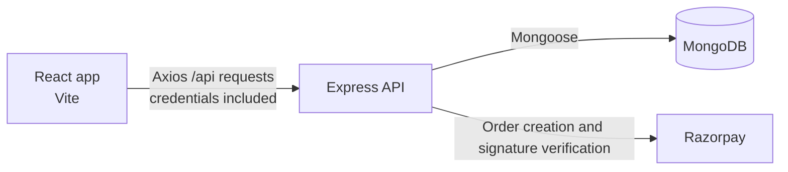

# Yoink

Yoink is a full-stack E-com platform for discovering products, managing a cart, and placing orders. Customers can search and filter a paginated catalog, save delivery addresses, and review products. Admins have a separate area for catalog, customer, and order oversight.

## Contents

- [Live demo](#live-demo)
- [Screenshots](#screenshots)
- [Features](#features)
- [Technology stack](#technology-stack)
- [Architecture](#architecture)
- [Prerequisites](#prerequisites)
- [Run locally](#run-locally)
- [Environment variables](#environment-variables)
- [API overview](#api-overview)
- [Database design](#database-design)
- [Testing](#testing)
- [Deployment](#deployment)
- [Security and engineering notes](#security-and-engineering-notes)

## Live demo
**https://yoink-taupe.vercel.app/**


## Features

### Customer

- Browse active products with search (name/description), category, price range, and featured filters, plus sorting by price, rating, name, or date, and pagination.
- View product details and manage your cart.
- Check out using saved or new shipping addresses.
- Pay via multiple methods: Cash on Delivery (COD) or online payment.
- View your orders and order details to track their status.
- Write, edit, and delete a review for each product.
- Switch between light and dark themes.
- Enjoy a fully responsive design that works seamlessly across all devices and screen sizes.

### Admin

- View dashboard totals along with paginated product and user lists.
- Create, edit, and delete products, and review categories, users, and orders.
- Update order status and mark eligible orders as paid.
### Admin

- View dashboard totals and paginated product and user lists.
- Create, edit, and delete products; review categories, users, and orders.
- Update order status and mark eligible orders as paid.

### Authentication and security

- Register, sign in/out, and load the current account; protected customer and admin routes.
- Server-side JWT authorization and role checks. Authentication uses an HTTP-only cookie (Bearer tokens are also accepted by the API).
- Customers can manage their own saved addresses, cart, and orders.

### Payments

- Cash on delivery is implemented, including server-calculated order totals and transactional stock decrement.
- Razorpay Checkout is wired into the frontend and backend: the server creates a Razorpay order from current cart prices and verifies the returned HMAC signature.
- Razorpay test mode: Online checkout uses Razorpay’s test environment, where you can simulate a successful or failed payment. Live payments are not enabled.

## Technology stack

| Area | Technologies |
| --- | --- |
| Frontend | React 18, Vite 5, React Router 6, TanStack Query 5, Axios |
| Backend | Node.js (ES modules), Express 4 |
| Database | MongoDB, Mongoose 8 |
| Authentication/security | bcrypt, JSON Web Token, CORS, HTTP-only cookies |
| Payments | Razorpay Node SDK and Razorpay Checkout |
| Testing/deployment | Node built-in test runner; Vercel rewrite configuration in `ui-yoink/vercel.json` |

## Architecture

The Vite React app calls the Express JSON API with Axios. The API connects to MongoDB through Mongoose. The browser sends credentials for the HTTP-only authentication cookie; CORS allows the configured frontend origin(s).



```text
yoink/
├── README.md
├── .env.example
├── svc-yoink/
│   ├── config/       # MongoDB connection
│   ├── controllers/  # API behavior
│   ├── middleware/   # JWT and role checks
│   ├── models/       # Mongoose schemas
│   ├── routes/       # API route definitions
│   ├── seed/         # Catalog seed script
│   ├── test/         # Node test-runner tests
│   └── server.js
└── ui-yoink/
    ├── src/          # React app, pages, components, API client
    ├── public/
    └── vercel.json
```

## Prerequisites

- Node.js and npm (versions are not pinned in the package manifests).
- A MongoDB instance. Use MongoDB Atlas or another replica-set-capable deployment for checkout transactions; a standalone local MongoDB does not support the COD transaction flow.

## Run locally

Run commands from the indicated directory. Clone URL is intentionally a placeholder because no repository URL is configured in the project files.

```bash
git clone <repository-url> yoink
cd yoink
```

### 1. Configure the backend

In **Terminal 1**, from `yoink/svc-yoink`:

```bash
npm install
```

Create `svc-yoink/.env` using the backend example below. Set `MONGO_URI` to your MongoDB connection string and provide a private `JWT_SECRET`.

### 2. Seed the catalog (optional)

With the backend environment configured, from `yoink/svc-yoink`:

```bash
npm run seed
```

The seed script upserts sample categories and products. It does not create an admin user.

### 3. Start the backend

In **Terminal 1**, from `yoink/svc-yoink`:

```bash
npm start
```

The API listens on port `5000` by default. The root health response is available at `http://localhost:5000/`.

### 4. Configure and start the frontend

In **Terminal 2**, from `yoink/ui-yoink`, create `.env` with `VITE_API_URL=http://localhost:5000`, then run:

```bash
npm install
npm run dev
```

Open the local URL printed by Vite (typically `http://localhost:5173`). Vite environment values are read at startup; restart the dev server after changing `.env`.

## Environment variables

Copy the example values as needed; never commit real secrets. The root `.env.example` combines frontend and backend examples. `svc-yoink/.env.example` is backend-only. There is no `ui-yoink/.env.example` in the repository. The backend sample omits the optional `JWT_EXPIRES_IN` and `JWT_COOKIE_MAX_AGE_MS` variables supported by the code; the configuration below includes them with their code defaults.

### Backend: `svc-yoink/.env`

```dotenv
PORT=5000
MONGO_URI=mongodb://localhost:27017/yoink
JWT_SECRET=<replace-with-a-long-random-secret>
JWT_EXPIRES_IN=7d
JWT_COOKIE_MAX_AGE_MS=604800000
CLIENT_URL=http://localhost:5173
RAZORPAY_KEY_ID=<razorpay-test-key-id>
RAZORPAY_KEY_SECRET=<razorpay-test-key-secret>
```

| Variable | Required | Purpose |
| --- | --- | --- |
| `PORT` | No | API listen port; defaults to `5000`. |
| `MONGO_URI` | Yes | MongoDB connection string; also used by the seed script. |
| `JWT_SECRET` | Yes for authentication | Secret used to sign and verify session JWTs. |
| `JWT_EXPIRES_IN` | No | JWT lifetime; defaults to `7d`. |
| `JWT_COOKIE_MAX_AGE_MS` | No | Cookie lifetime in milliseconds; defaults to seven days. |
| `CLIENT_URL` | No | Comma-separated allowed CORS origin(s); defaults to `http://localhost:5173`. |
| `RAZORPAY_KEY_ID` | For Razorpay | Public checkout key ID returned to the frontend by the API. |
| `RAZORPAY_KEY_SECRET` | For Razorpay | Server-side order creation and signature-verification secret. Keep private. |

### Frontend: `ui-yoink/.env`

```dotenv
VITE_API_URL=http://localhost:5000
```

| Variable | Required | Purpose |
| --- | --- | --- |
| `VITE_API_URL` | No | API origin; defaults in the client to `http://localhost:5000`. |

Vite embeds `VITE_*` values in browser-visible code. Do not put passwords, private tokens, or the Razorpay secret in frontend variables. The Razorpay key ID is provided by the backend when creating a payment order.

## API overview

All routes are prefixed with `/api`. Protected routes require a valid session cookie or `Authorization: Bearer <token>`. `Admin` means authenticated with role `admin`.

| Group | Method and path | Access | Purpose / useful input |
| --- | --- | --- | --- |
| Authentication | `POST /auth/check-email` | Public | Check `{ "email" }`. |
|  | `POST /auth/register` | Public | Register with `{ "name", "email", "password" }`; assigns customer role. |
|  | `POST /auth/login` | Public | Sign in with `{ "email", "password" }`. |
|  | `POST /auth/logout` | Public | Clear auth cookie. |
|  | `GET /auth/me` | Customer | Current account. |
| Addresses | `POST /auth/addresses` | Customer | Add address (`fullName`, `addressLine1`, `city`, `state`, `postalCode`, `country`; optional `addressLine2`, `label`). |
|  | `PATCH /auth/addresses/:addressId/default`, `DELETE /auth/addresses/:addressId` | Customer | Set default or remove own saved address. |
| Products | `GET /products` | Public | Catalog query: `search`, `category` (ID), `minPrice`, `maxPrice`, `featured`, `sortBy` (`price`, `rating`, `name`, `newest`), `order`, `page`, `limit` (max 48). |
|  | `GET /products/:idOrSlug` | Public | Product detail by ID or slug. |
|  | `POST /products`, `PATCH /products/:id`, `DELETE /products/:id` | Admin | Create, update, or delete a product. |
| Categories | `GET /categories` | Public | Categories with active products. |
| Cart | `GET /cart`, `DELETE /cart` | Customer | Read or clear own cart. |
|  | `POST /cart/items` | Customer | Add `{ "productId", "quantity" }` (quantity defaults to 1). |
|  | `PATCH /cart/items/:productId`, `DELETE /cart/items/:productId` | Customer | Update quantity or remove item. |
| Orders | `POST /orders` | Customer | Place COD order with `{ "shippingAddress": { ... } }` and `Idempotency-Key` header. |
|  | `POST /orders/razorpay` | Customer | Create pending online-payment order with shipping address and `Idempotency-Key`. |
|  | `POST /orders/razorpay/verify` | Customer | Verify `{ "applicationOrderId", "razorpay_order_id", "razorpay_payment_id", "razorpay_signature" }`. |
|  | `GET /orders/my-orders`, `GET /orders/:id` | Customer / owner (admins may read any order) | Read own orders or a permitted order. |
|  | `GET /orders` | Admin | Paginated order list (`page`, `limit`, max 50). |
|  | `PATCH /orders/:id/status` | Admin | Set `status` to `pending`, `processing`, `shipped`, `delivered`, or `cancelled`. |
|  | `PATCH /orders/:id/payment/paid` | Admin | Mark an eligible order as paid. |
| Reviews | `GET /products/:idOrSlug/reviews` | Public | List product reviews. |
|  | `POST /products/:idOrSlug/reviews` | Customer | Create `{ "rating" (1–5), "comment" }`; one review per user/product. |
|  | `PATCH /reviews/:reviewId`, `DELETE /reviews/:reviewId` | Review owner | Edit or delete own review. |
| Admin | `GET /admin/dashboard/stats`, `/admin/products`, `/admin/categories`, `/admin/users` | Admin | Dashboard totals and admin listings; products/users accept pagination. |

## Database design

The app uses these Mongoose collections:

| Model | Purpose and constraints |
| --- | --- |
| `User` | Normalized unique email, bcrypt password hash excluded from default queries, `user`/`admin` role, embedded saved addresses and default address reference. |
| `Category` | Unique lowercase slug and image URL. |
| `Product` | Unique slug, category reference, price, image URLs, integer stock, featured/active flags, and rating summary. Text and catalog indexes support search and listing. |
| `Cart` | One cart per user; product references and positive integer quantities. |
| `Order` | User reference, embedded shipping address and item snapshots, server-calculated total, order/payment states, payment identifiers, and idempotency key. |
| `Review` | User and product references, integer rating from 1–5, bounded comment, and unique user/product pair. |

COD order creation uses a MongoDB transaction to decrement stock, create snapshot records, and clear the cart atomically. Product deletion is hard deletion and also removes associated reviews; there is no product soft-delete endpoint (the `isActive` flag can instead hide products). MongoDB references are application-level references rather than relational foreign keys.

## Testing

Backend tests use Node.js's built-in test runner. From `svc-yoink`:

```bash
npm test
```

Existing tests cover auth response shape, cart helpers, catalog query/product validation, order address/schema rules, admin pagination/statistics/authorization, Razorpay order creation behavior, and review validation/access behavior. This is focused test coverage, not a claim of complete application or end-to-end coverage. The frontend package defines no test script.

## Deployment

The repository includes `ui-yoink/vercel.json` with a single-page-app rewrite for frontend routing. No verified production frontend/API URL, backend hosting configuration, or MongoDB provider is recorded in the repository, so deployment destinations are left as placeholders above.

For a deployment, configure the backend's `MONGO_URI`, `JWT_SECRET`, and `CLIENT_URL` for the deployed frontend origin. Configure `RAZORPAY_KEY_ID` and `RAZORPAY_KEY_SECRET` only when enabling Razorpay. Build the frontend with `npm run build` from `ui-yoink` and set `VITE_API_URL` to the deployed API origin at build time. The backend start command is `npm start` from `svc-yoink`. Use a MongoDB replica set/Atlas cluster for COD checkout transactions and HTTPS in production.

## Security and engineering notes

- Passwords are hashed with bcrypt (12 rounds); public user responses omit password credentials.
- JWTs are stored in HTTP-only cookies with production `Secure` and `SameSite=None` settings; the API also accepts Bearer tokens.
- The backend enforces authentication and admin authorization independently of frontend route guards.
- Product prices and order totals come from database records, and cart quantities/available stock are checked server-side.
- COD stock changes and order/cart updates are transactional. Razorpay currently lacks equivalent stock reservation/decrement and webhook/refund handling; see [Payments](#payments).
